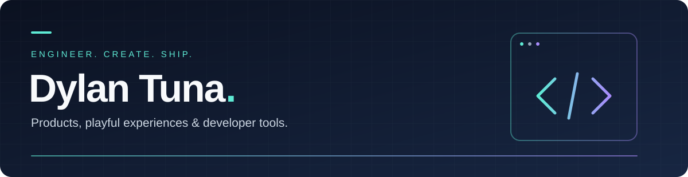
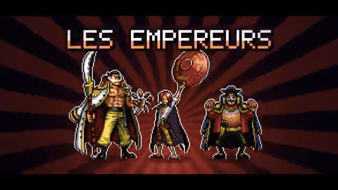
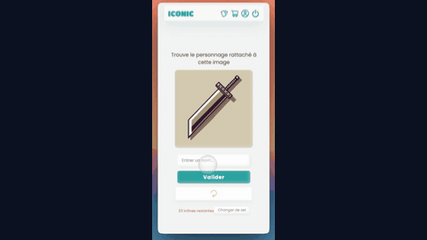

<p align="center">
  
</p>

<h1>Senior Full-Stack Developer &amp; AI Product Engineer</h1>

**I build browser games, AI workflows and TypeScript tools — backed by 9 years of SaaS engineering.**

My stack spans **TypeScript, React, Next.js and Node.js**, with **AI agents, skills and development workflows**. Explore my games below, including FASTR's dictionary automation, or inspect **Unbox**, my TypeScript utility published on npm.

**Backend & delivery:** NestJS · GraphQL · PostgreSQL · MongoDB · AWS · Docker · CI/CD

**Discuss a role or a project:** [LinkedIn →](https://www.linkedin.com/in/dylan-tuna-635405a8/) · [X / @DylanTuna](https://x.com/DylanTuna) · [YouTube / Corvus Web Studio](https://www.youtube.com/@CorvusWebStudio)

<p>
  <a href="#games">Games</a> &nbsp; / &nbsp;
  <a href="#technical-stack">Technical stack</a> &nbsp; / &nbsp;
  <a href="#open-source">Open source</a> &nbsp; / &nbsp;
  <a href="#typescript-patterns">TypeScript patterns</a> &nbsp; / &nbsp;
  <a href="https://github.com/cendevweb?tab=overview#js-contribution-activity-description">GitHub activity</a>
</p>

## Games

Three projects you can try, each with approximately **1,000 visits since launch**. Previews link to the full trailers.

### ONE PIEXEL — pixel-art fighting game

**50 registered accounts** since its recent launch.

[Play ONE PIEXEL →](https://one-piexel.gg/) · [Full trailer · 1:39](https://youtu.be/ONCxnPIFi60?si=W1M6P9zhqSow09BI)

<a href="https://github.com/cendevweb/cendevweb/blob/main/assets/one-piexel-trailer.mp4">
  <picture>
    <source media="(prefers-reduced-motion: reduce)" srcset="assets/one-piexel-poster.jpg" />
    
  </picture>
</a>

<sub>Approximate totals since launch, as of October 2026. Visits and registered accounts are separate metrics.</sub>

### FASTR — multiplayer word race

Race other players to find words within a theme across four timed rounds. No account is required.

- **AI dictionary workflows:** reusable skills to create and improve dictionaries, and incorporate automatically collected player suggestions.
- **Backoffice:** an interface to manage dictionaries and their workflows.
- **Real-time interaction:** WebSocket development for the multiplayer experience.

[Play FASTR →](https://fastr.gg/) · [Full trailer · 1:32](https://youtu.be/jz26XgZvl_w?si=q0eZP8WZK3o5gxBR)

<a href="https://github.com/cendevweb/cendevweb/blob/main/assets/fastr-trailer.mp4">
  <picture>
    <source media="(prefers-reduced-motion: reduce)" srcset="assets/fastr-poster.jpg" />
    
  </picture>
</a>

### ICONIC — guess the character from an icon

Identify characters from visual clues, with progress tracking and streak bonuses.

**100 registered accounts** since launch.

[Play ICONIC →](https://iconic-game.gg/) · [Full trailer · 0:32](https://www.instagram.com/p/DN_3U63AlTN/)

<a href="https://github.com/cendevweb/cendevweb/blob/main/assets/iconic-trailer.mp4">
  <picture>
    <source media="(prefers-reduced-motion: reduce)" srcset="assets/iconic-poster.jpg" />
    
  </picture>
</a>

**Account management:** Next.js with Better Auth / Auth.js across ICONIC and ONE PIEXEL.

## Technical stack

**Frontend**


**Backend & data**


Real-time communication with **WebSockets** · Account management with **Better Auth / Auth.js**

**Cloud, delivery & payments**


AWS Lambda · Serverless · API Gateway · Load balancing · CI/CD with GitHub Actions · Stripe integrations

**AI product engineering & agentic development**


Claude Code and Codex for development, with reusable **agent skills, rules and workflow orchestration**.

## Open source

### Unbox — explicit error handling for promises

**TypeScript · Published on npm**

Promise rejection is easy to overlook. `unbox` and `unboxAll` expose errors alongside the result, encouraging callers to handle failure before using the data.

[Explore the source →](https://github.com/cendevweb/unbox) · [View on npm →](https://www.npmjs.com/package/unbox-js)

```ts
const result = await unbox(userPromise);

if (result.error) {
  throw result.error;
}

const { data } = result;
```

## TypeScript patterns

Practical snippets for everyday development, including the four gists pinned on my profile. The examples cover both TypeScript typing and JavaScript runtime behavior.

| Pattern | What it demonstrates |
| :--- | :--- |
| [Function overloads](https://gist.github.com/cendevweb/cf22bca87833bd358cca86c2ccbaf73c) | Express different return types for different input signatures. |
| [Lookup tables](https://gist.github.com/cendevweb/db42f2bf8fa5f16fa42d50e2d0502d6a) | Represent status mappings as data for straightforward lookups. |
| [Conditional object spread](https://gist.github.com/cendevweb/8d4705121ac7cdfe860167b0dd59649c) | A compact example of conditional object spread with a `typeof` check. |
| [Proxy validator](https://gist.github.com/cendevweb/d2022012c4907d51ca98610169157018) | Intercept property assignments with a JavaScript `Proxy`. |

[Browse all my gists →](https://gist.github.com/cendevweb)

## SaaS background

**9 years of experience** across **Paragone, lempire, Weblib and SportsDynamics**, including work on **Tweet Hunter and Taplio at lempire**.

<details>
<summary>Selected engineering contributions &amp; AWS certification</summary>

Across my SaaS roles:

- **Backend systems:** matrix-based domain models, opaque types and task orchestration for content preparation and ad publishing from advanced form inputs.
- **Automation:** automated Twitter bots and publishing workflows.
- **AWS infrastructure:** Lambda and serverless development, API Gateway configuration and load balancing.
- **Data engineering:** MongoDB and PostgreSQL database redesigns, including work with Prisma.

**AWS Certified Developer – Associate — earned in 2019.**

</details>

---

<p align="center">
  <strong>Hiring for full-stack development or AI product engineering?</strong><br />
  <a href="https://www.linkedin.com/in/dylan-tuna-635405a8/">Let's talk on LinkedIn →</a>
</p>

<!-- GitHub renders the live native contribution calendar and activity overview below this README and pinned items. -->
